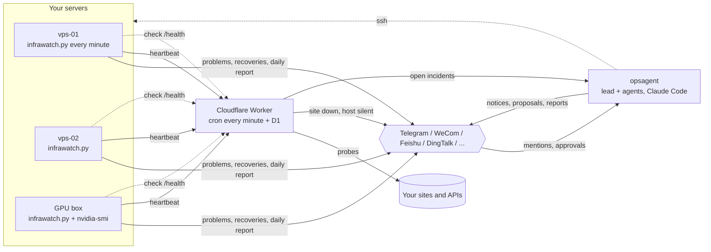

# infra-alert-skills

**English** · [Tiếng Việt](README.vi.md) · [简体中文](README.zh-CN.md)

Agent skills that let Claude set up and run monitoring for a small infrastructure, and tell you in a chat when
something breaks and when it is back: a few VPSes, a GPU machine, services behind Cloudflare. Alerts go to
Telegram, or to WeCom, Feishu/Lark, DingTalk, Bark, ntfy, ServerChan, PushPlus or any webhook.

You say what you want watched. Claude looks at the server, proposes what to watch, installs a one-file monitor,
proves an alert really arrives, and later helps you work out what an alert means. If you want, agents then sit in
the chat itself: they pick up a critical alert nobody has taken, fix what your policy allows, ask before anything
else, and answer when you mention them.

```
[infrawatch] 🔴 URGENT | vps-01: 1 problem, 1 resolved
🔴 disk /: 96% used, 1.8 GB free
✅ http api: HTTP 200 (after 12m)
#urgent #vps_01
```

It grew out of how we watch [allshorts.net](https://allshorts.net) (a few servers, a GPU machine and Cloudflare,
all reporting to one Telegram chat) and was then rebuilt for general use after reading how Uptime Kuma, Gatus,
Healthchecks, Nezha, Beszel and others do it. Our approach to security, crawler blocking and alerting is in
[docs/approach.md](docs/approach.md); what we took from whom is in [docs/prior-art.md](docs/prior-art.md).

## What is in it

| Skill | What Claude does with it |
|---|---|
| [`setup-alert-channel`](skills/setup-alert-channel/SKILL.md) | Walks you through creating a Telegram bot and a channel or group, finds the chat id, stores the token safely, sends a test message. Covers eight other channels for where Telegram is not an option |
| [`monitor-hosts`](skills/monitor-hosts/SKILL.md) | Installs `infrawatch.py` on a Linux server over SSH: disks, memory, load, systemd services, Docker containers, HTTP/TCP endpoints, TLS certificates, NVIDIA GPUs, reboots, OOM kills, and an optional security baseline |
| [`monitor-cloudflare`](skills/monitor-cloudflare/SKILL.md) | Deploys a Cloudflare Worker (free plan) that probes your URLs every minute from outside and alerts when a host stops sending heartbeats |
| [`triage-alerts`](skills/triage-alerts/SKILL.md) | Given an alert, finds the cause with read-only commands, proposes the fix, and tunes alerts that are noise |
| [`run-ops-agents`](skills/run-ops-agents/SKILL.md) | Puts agents into the Telegram alert group: a lead that watches open incidents and hands them out, agents that diagnose, fix within a policy, ask for approval with buttons, report, and answer `@mentions` |



Two pieces, each useful alone, stronger together:

- **`infrawatch.py`**, on each host: one Python file, standard library only, run by a systemd timer. No daemon, no
  database, no agent to keep up to date.
- **The Worker**, outside your hosts: sees what a machine that is off cannot report. The hosts check the Worker
  back, so neither can die unnoticed.

## Install

In Claude Code:

```
/plugin marketplace add lovecastle/infra-alert-skills
/plugin install infra-alerts@infra-alert-skills
```

Or with the [skills CLI](https://github.com/vercel-labs/skills), for Claude Code and other agents that read `SKILL.md`:

```bash
npx skills add lovecastle/infra-alert-skills
```

The skills need an agent with a shell (they use `ssh`, `scp`, `curl`, `npx wrangler`). In the Claude apps without
one, `setup-alert-channel` still works as a guide: zip the skill's folder and upload it under Customize → Skills.

## Use

Say it in your own words, in any language. For example:

| You want | Say |
|---|---|
| A Telegram bot and channel for alerts | "Set up a Telegram channel for my server alerts" |
| A server watched | "Install monitoring on `vps-01` (that's my ssh alias) and alert me on Telegram when something is wrong" |
| A GPU machine watched | "`rtx` runs our inference service on an RTX card. Watch the GPU too, and tell me if the job dies" |
| To know when a server or site is fully down | "Deploy the Cloudflare watcher: probe https://example.com and alert me if vps-01 or vps-02 goes silent" |
| An alert explained | "I got this: `[infrawatch] 🔴 vps-01: memory: 97% used`. What is going on?" |
| Quiet during a deploy | "Silence alerts on vps-01 for an hour" |
| Categories in your language, a topic each | "Label alerts in Vietnamese and send urgent ones to the Urgent topic of our group" |
| Agents in the alert group | "Put an agent in our alert group: if nobody reacts to a critical alert in 5 minutes it should start on it, restart services by itself and ask before anything else" |
| An agent to do something, from the chat | In the group: `@web_bot why is vps-01 slow?` |

Claude asks before it changes anything on a server or creates anything in your Cloudflare account, and shows you a
dry run (`infrawatch.py check`) before turning monitoring on.

## How alerts behave

The rules that keep an alert chat worth reading:

- **Changes only.** A problem is told when it starts and when it ends, with how long it lasted. Not every minute.
- **Confirmed before told.** Three bad readings in a row on a host, two failed probes from the Worker. One bad
  minute tells nobody.
- **No flapping.** An open alert clears only a little below its threshold.
- **One message per run**, everything that changed in it. New problems make a sound; recoveries and reports do not.
- **Critical problems are repeated** every 4 hours while open; warnings are said once.
- **A message the chat service refused is kept** and sent with the next run.
- **Silence that still watches**: `silence 2h` for maintenance; when it ends you are told what is still wrong.
- **A daily report** that doubles as proof of life: if it did not come, the monitor is what broke.
- **Someone watches the watcher**: hosts send heartbeats to the Worker; the Worker's `/health` is checked by hosts.
- **Every message says what it asks of you.** One category each: 🔴 URGENT (act now), 🟠 ATTENTION (look today),
  🛡 SECURITY ("was that you?"), ✅ RESOLVED, 📊 STATS. The word is in the title, in your language; a fixed tag
  (`#urgent`, `#stats`, `#vps_01`) lets you filter the chat; on Telegram each category can have its own topic, so
  people mute "Stats" and keep "Urgent" loud. [Details](skills/monitor-hosts/references/checks.md#categories).


## Agents in the chat (optional)

The monitors tell the chat; [`run-ops-agents`](skills/run-ops-agents/SKILL.md) adds someone who is always there to
read it. `opsagent.py` runs one or more agents, each a Telegram bot in your alert group:

- **A lead watches what is open** (the Worker's `/incidents`: every alert open on every host, plus what the Worker
  sees). A critical incident gets a notice with two buttons: *I take it* and *Start now*.
- **If no admin takes it within the grace time** (5 minutes by default), the agent that knows that host starts on
  it: it diagnoses over SSH with Claude Code in headless mode, following `triage-alerts`.
- **It fixes only what your written policy allows** (restart a named service, vacuum logs). For anything else it
  posts a proposal (what it found, the exact commands, what they interrupt, how to undo them, how it will check)
  with *Approve* and *Refuse* buttons. No answer in 30 minutes is a no.
- **It reports in the chat**: cause, what it did, result, what is still open. An incident still open 15 minutes
  after an agent called it done is handed back to the admins, loudly.
- **Admins talk to agents in the chat**: `@agent <order or question>`, or a reply to its message. Several agents
  can sit in the group, each with its own area; the lead hands work to the right one.

What keeps this safe is not the model's judgement. Only the Telegram user ids you list are heard (being in the
group gives no say); approval is a button the daemon checks; agents log in to servers with an account that has a
short sudoers list; `/pause` stops them. Read [access.md](skills/run-ops-agents/references/access.md) first.

Idle agents cost nothing: Claude Code is started only when there is work, once per piece of work.

## What gets installed

On each host (remove with one command, listed in the skill):

```
/opt/infrawatch/infrawatch.py                       the monitor
/etc/infrawatch/config.ini                          what to watch; no secrets
/etc/infrawatch/notify.env                          tokens; root only, mode 600
/etc/systemd/system/infrawatch.{service,timer}      runs it every minute
/var/lib/infrawatch/state.json                      open alerts, baselines
```

In your Cloudflare account: one Worker (`infra-alerts`) and one D1 database, inside the free plan for a setup of
this size ([the numbers](skills/monitor-cloudflare/references/limits.md)).

With agents, on one always-on machine of yours: `/opt/opsagent/opsagent.py`, `/etc/opsagent/agents.ini` and
`agents.env` (bot tokens, mode 600), a systemd service, and an `opsagent` account with a short sudoers list on each
server.

On your own machine: `~/.infra-alerts/notify.env` (mode 600), the one place tokens are kept before they are copied
to hosts and Worker secrets.

Nothing reports to us or to any third party. The only outbound traffic is to the chat services you configure and
between your hosts and your Worker.

## Channels

| Channel | Host agent | Worker | Notes |
|---|:-:|:-:|---|
| Telegram | ✅ | ✅ | groups, channels, forum topics; `TG_API_HOST` for a proxy |
| WeCom / 企业微信 group bot | ✅ | ✅ | |
| Feishu / Lark custom bot | ✅ | ✅ | signature supported |
| DingTalk / 钉钉 group bot | ✅ | ✅ | signature or keyword `infra` |
| Generic webhook | ✅ | ✅ | JSON `{title, body, level, source}` |
| Bark, ntfy, ServerChan (Server酱), PushPlus | ✅ | – | |

Key names follow the 青龙 (Qinglong) convention (`TG_BOT_TOKEN`, `QYWX_KEY`, `DD_BOT_TOKEN`, …), so an existing
config can be pasted in. Setup for each: [other-channels.md](skills/setup-alert-channel/references/other-channels.md).

## Status and what has been tested

Version 0.2.0. Be clear-eyed about an early release:

- `infrawatch.py`: 46 tests, run on Python 3.8 and 3.11. The collectors are tested against recorded output of
  `df`, `/proc`, `systemctl`, `docker`, `nvidia-smi`, `ss` and `journalctl`; the alert logic and the commands are
  tested end to end against a local stand-in for Telegram.
- The Worker: 16 tests on Node with a real SQL engine standing in for D1, and a run in Cloudflare's runtime
  (`wrangler dev`) through an outage, a recovery, heartbeats and the endpoints.
- `opsagent.py`: 19 tests on Python 3.8 and 3.11, one of them the whole daemon (threads, long polling, buttons,
  approval) against a local server playing Telegram and the Worker, with a stand-in for `claude -p`. The command
  line was accepted by a real Claude Code 2.1; the shape of a successful structured answer follows its
  documentation and has not been seen from a signed-in run. **It has not been run against live Telegram or on real
  incidents.** Start it with `grace_minutes` high and a short sudoers list, and watch it.
- **Not yet done:** this version of the host monitor has not been run on a production Linux host by its authors, and the
  channels other than Telegram follow each service's documentation but have not been sent through the live
  services. That is why the install skill makes Claude run `check` and `test` on your host and read the output
  with you before anything is enabled. If a check misreads your system, please open an issue with the `check`
  output.

Run the tests:

```bash
python -m unittest discover -s tests
node --test tests/worker.test.mjs
```

## Not included (yet)

Deliberately left out of the first version; open an issue if you need one:

- History, graphs, a status page. This tells a chat; it does not keep metrics. Use Beszel or Netdata beside it.
- Alerts from Cloudflare analytics (5xx rate, Worker errors, quota use). [docs/approach.md](docs/approach.md)
  describes the approach; it depends on the application.
- Windows and macOS hosts.
- Agents on channels other than Telegram. Alerts go everywhere; agents live in a Telegram group.
- The monitor acting by itself. `infrawatch.py` only tells; acting is for a person, or for the agents under your
  policy.

## License

MIT. See [LICENSE](LICENSE).
